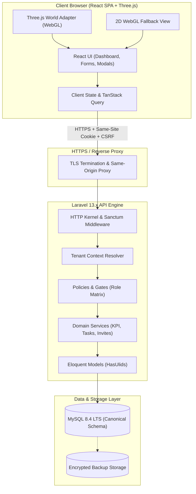

# ORBIS Architecture Specification

**Version:** 1.0.0-reconciled  
**Status:** Reconciled architectural baseline for implementation  
**Backend:** Laravel 13.x (PHP 8.3+)  
**Frontend:** React + TypeScript + Vite  
**Database:** MySQL 8.4 LTS  
**3D World:** Three.js (Isolated module)

---

## 1. System Overview & Boundaries

The ORBIS platform is designed as a modular, multi-tenant SaaS application operating under a strict separation of concerns between visual rendering, client state, business logic, and persistence.



---

## 2. Core Subsystems

### 2.1 Backend Application (`apps/api`) — Laravel 13.x
- **Framework Kernel:** Laravel 13.x running on PHP 8.3.26+ in Laragon/production.
- **Bootstrap Architecture:** Modern `bootstrap/app.php` pipeline configuring:
  - Routing: `routes/api.php` prefixed under `/api/v1`.
  - Middleware: `EnsureFrontendRequestsAreStateful` (Sanctum SPA mode), `ResolveTenantContext`, and `ValidateCsrfToken`.
  - Standardized exception formatting returning `{ code, message, errors, request_id }`.
- **Entity Identification:** Native ULID (`CHAR(26)`) using `Illuminate\Database\Eloquent\Concerns\HasUlids`.
- **Data Access Layer:** Thin controllers delegating to validated Form Requests, authorization Policies, and transactional Application Services.
- **Tenant Scoping:** All tenant-owned Eloquent queries enforce a global tenant scope:
  ```php
  static::addGlobalScope('tenant', function (Builder $builder) {
      if ($companyId = current_company_id()) {
          $builder->where($builder->qualifyColumn('company_id'), $companyId);
      }
  });
  ```

### 2.2 Frontend Application (`apps/web`) — React + TypeScript + Vite
- **UI Stack:** React 18/19, TypeScript 5.x, Vite 6+, TanStack Query for asynchronous server state.
- **Visual Design:** Dark navy glassmorphism (`#061325`, `#081a33`, `backdrop-filter: blur(14px)`), electric cyan (`#35d8ff`), and amber gold accents (`#f5b342`).
- **Feature Modules:**
  - `features/auth`: Login, company switching, session lifecycle.
  - `features/organization`: Branches, departments, members, invitations.
  - `features/projects`: Project roadmaps, leads, task-derived progress bars.
  - `features/tasks`: Master task table, status transitions, comments.
  - `features/dashboard`: Fullscreen Quick Dashboard, KPI cards, alerts feed.
  - `features/reports`: Operational reports, date filtering, CSV streaming export.
  - `world/`: Three.js scene engine, camera controller, minimap radar, floating labels.

### 2.3 3D Spatial Adapter (`apps/web/src/world`) — Three.js
- **Isolation Principle:** The Three.js canvas is strictly a spatial visualization viewport. It holds zero business logic and does not maintain client authoritative state.
- **Scene Lifecycle:** Mounted via `ThreeCanvasContainer.tsx`. Geometries, materials, textures, and requestAnimationFrame loops are explicitly disposed on unmount to prevent WebGL memory leaks.
- **Fallback Guarantee:** A feature-detection wrapper inspects WebGL availability and context loss (`webglcontextlost`). If WebGL is unsupported or crashes, the UI gracefully renders `WebGLFallback.tsx`, presenting the 2D Quick Dashboard and grid navigation.

---

## 3. Monorepo Structure

```text
orbis/
├── apps/
│   ├── api/                     # Laravel 13.x backend
│   │   ├── app/
│   │   │   ├── Http/Controllers/
│   │   │   ├── Http/Middleware/
│   │   │   ├── Models/
│   │   │   ├── Policies/
│   │   │   └── Services/
│   │   ├── bootstrap/app.php
│   │   ├── config/
│   │   ├── database/migrations/
│   │   ├── routes/api.php
│   │   └── tests/
│   └── web/                     # React + TypeScript + Vite frontend
│       ├── src/
│       │   ├── components/
│       │   ├── features/
│       │   ├── world/           # Three.js scene modules
│       │   ├── App.tsx
│       │   └── main.tsx
│       ├── index.html
│       ├── package.json
│       └── vite.config.ts
├── packages/
│   └── api-contract/            # Shared TypeScript API types
├── database/                    # Canonical SQL reference and ERD
│   ├── ERD.mmd
│   ├── DATA_DICTIONARY.md
│   └── schema.mysql.sql
├── docs/                        # Synchronized specifications
│   ├── PRD.md
│   ├── ARCHITECTURE.md
│   ├── DECISIONS.md
│   ├── SECURITY.md
│   ├── TEST_PLAN.md
│   └── DEPLOYMENT.md
└── artifacts/audit/             # Specification audit reports
```

---

## 4. Multi-Tenant Isolation & Trust Boundaries

1. **Untrusted Client:** The browser client is completely untrusted. Any client-provided `company_id`, role string, or status is treated as user input, never proof of authorization.
2. **Session-Bound Tenant Context:** The active `company_id` is resolved exclusively from the server-side authenticated session (`current_company_id`). Switching company context requires active membership validation against `company_user`.
3. **Composite Foreign Keys:** Database schema enforces multi-tenant integrity at the storage engine level. A task cannot reference a branch, department, or project from another company because foreign keys enforce `(company_id, referenced_id)` composite constraints.
4. **Non-Disclosing Rejection:** Attempting to query an ID belonging to another tenant returns `404 Not Found` rather than `403 Forbidden`, preventing resource existence probing.
