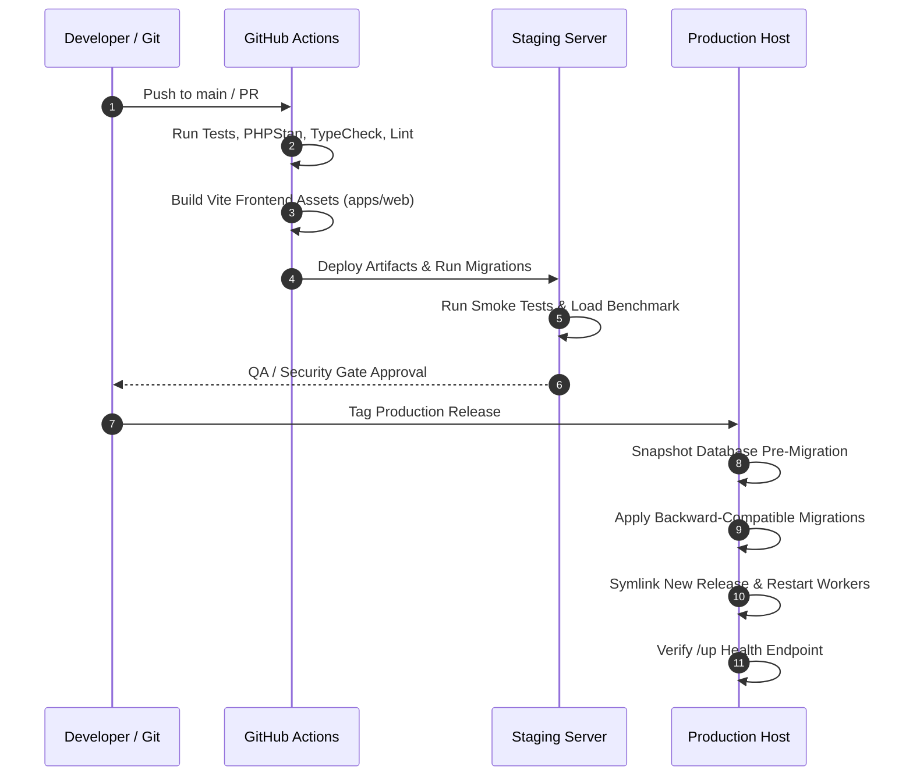

# ORBIS Deployment & Operations Plan

**Version:** 1.0.0-reconciled  
**Status:** Reconciled operations baseline  
**Lead:** Operations Owner & Tech Lead

---

## 1. Environments

- **Local:** Laragon environment (PHP 8.3.26, MySQL 8.4.3 LTS, Node v24.11.1). Disposable development data; `.env` excluded from version control.
- **CI / Pipeline:** GitHub Actions runner executing PHPUnit/Pest tests, PHPStan static analysis, ESLint, TypeScript typechecking, and migration drills against MySQL 8.4 service container.
- **Staging:** Production-mirror environment with synthetic multi-tenant test data (OD-013 profile: 20 companies, 2,000,000 tasks). Validates backward-compatible migrations, asset compilation, and rollback drills.
- **Production:** Hardened environment with HTTPS TLS termination, automated daily encrypted backups, least-privilege database users, and structured observability.

---

## 2. Operational Targets (Provisional Baseline)

- **Monthly Availability:** Target 99.5% uptime (excluding scheduled maintenance windows).
- **Latency SLO:** p95 latency ≤ 400 ms on core read endpoints (`/dashboard/summary`, `/tasks`, `/branches`) under agreed 50-concurrency workload.
- **Recovery Point Objective (RPO):** 24 hours (maximum data loss window in disaster recovery).
- **Recovery Time Objective (RTO):** 8 hours (maximum time to restore full service from backup).

---

## 3. Build & Release Pipeline

---

## 4. Configuration & Secrets Management

- **Environment Variables:** All application secrets (`APP_KEY`, database credentials, mail transport keys, session encryption keys) reside in server environment configuration. Committing `.env` to Git is strictly blocked.
- **Production Flags:**
  - `APP_ENV=production`
  - `APP_DEBUG=false`
  - `SESSION_SECURE_COOKIE=true`
  - `SESSION_SAME_SITE=lax`
- **Database Credentials:** Application connects using an unprivileged database user (`orbis_app`) granted access only to the application database. Administrative DDL operations run under a dedicated migration runner user.

---

## 5. Backup & Disaster Recovery Procedures

1. **Automated Daily Backups:**
   - Scheduled cron executes automated mysqldump at 02:00 UTC.
   - Output is compressed, encrypted via AES-256 (`gpg`), and synced to an isolated offsite replica storage bucket.
   - Backup retention: Daily backups retained for 30 days; weekly backups retained for 12 months.
2. **Periodic Restore Drills:**
   - Every quarter, the operations owner conducts a restore rehearsal into an isolated sandbox database.
   - Verification checklist: Row counts match snapshot metadata; referential foreign keys validate; application connects and passes health check.
   - A backup is not certified until the restore drill succeeds within the 8-hour RTO.

---

## 6. Observability & Health Checks

- **Application Health:** Laravel 13 native `/up` endpoint monitored continuously by external uptime monitors.
- **Structured Logging:** Application logs emitted in structured JSON format, including `timestamp`, `level`, `request_id`, `actor_id`, and `route`. Passwords, session cookies, and invitation tokens are automatically redacted.
- **Frontend Telemetry:** WebGL initialization errors and context losses are reported to error tracking without logging user PII.
