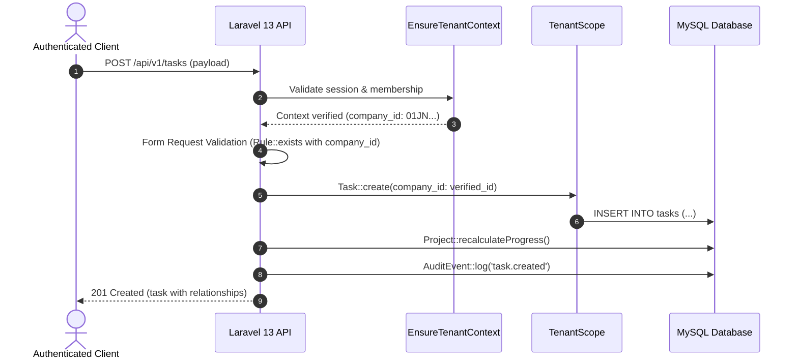

# ORBIS — System Architecture & Data Flow Review

## 1. System Overview
ORBIS is an enterprise operational SaaS platform combining business management (companies, branches, departments, memberships, projects, tasks) with an interactive 3D isometric operational campus visualization built with Three.js, supported by a 2D topological fallback.

```mermaid
graph TD
    Client[React 19 + TypeScript SPA] -->|Cookies & Bearer| ViteProxy[Vite Dev / Nginx Gateway]
    ViteProxy -->|HTTP / JSON| LaravelAPI[Laravel 13.38 REST API]
    LaravelAPI -->|Sanctum Stateful / CSRF| SessionGuard[Session & Auth Guard]
    SessionGuard -->|EnsureTenantContext| TenantContext[Tenant Context Resolver]
    TenantContext -->|#[ScopedBy TenantScope]| Eloquent[Eloquent Scoped Models]
    Eloquent -->|TCP 3306| MySQL[(MySQL 8.4 LTS DB)]
    Client -->|WebGL Engine| ThreeJS[Three.js Isometric Scene]
    Client -->|DOM Fallback| Canvas2D[2D Topological Campus Grid]
```

---

## 2. Multi-Tenant Architectural Model

### 2.1 Tenant Resolution Layer
- Tenant context is strictly determined **server-side** from authenticated user state via `EnsureTenantContext` middleware.
- Request payload parameters (`company_id`, `tenant_id`) from client bodies, headers, or query parameters are **never trusted** as tenant identifiers.
- Active company context is maintained in `session('current_company_id')`.
- On every incoming request, `EnsureTenantContext` verifies that the authenticated `User` possesses an active `CompanyUser` membership record for `session('current_company_id')`.
- If no membership exists, the request is immediately terminated with HTTP `403 Forbidden` (`code: TENANT_ACCESS_DENIED`).

### 2.2 Model Scoping Layer (`TenantScope`)
All tenant-owned resources implement the PHP 8 attribute `#[ScopedBy([TenantScope::class])]`:
1. `Branch`
2. `Department`
3. `Project`
4. `Task`
5. `TaskComment`
6. `TaskStatusHistory`
7. `Alert`
8. `KpiDefinition`
9. `KpiSnapshot`
10. `WorldConfig`

When `session('current_company_id')` is active, `TenantScope` automatically injects:
```sql
WHERE {table}.company_id = ?
```
into every Eloquent query builder, preventing accidental cross-tenant data leakage across all controllers, relationships, and queries.

---

## 3. Data Flow & Boundary Validation

### 3.1 Task Operations Workflow


### 3.2 3D Campus vs 2D Fallback Architecture
- The Three.js visualizer consumes JSON data strictly scoped to the active tenant via `/api/v1/dashboard/metrics` and `/api/v1/branches`.
- WebGL feature detection is performed at initialization. If WebGL is unavailable or user toggles the HUD switch, the interface renders `Topological Campus Network` using pure CSS grid and canvas primitives without disrupting data state.

---

## 4. Reconciliation with Specifications & Prototypes
- **PRD / ERD Compliance**: The database schema conforms strictly to the unified ERD (OD-001 through OD-013 in `DECISION_REGISTER.md`).
- **Identifier Strategy**: Canonical ULIDs (26-character Crockford base32 strings) are used for all entity primary and foreign keys, preventing sequential enumeration attacks.
- **Project Progress**: Formula accounts for `backlog` in the denominator per OD-003, preventing premature 100% progress reporting.
